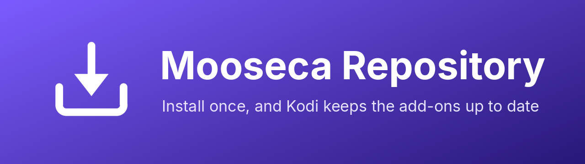

<p align="center">
  
</p>

<p align="center">
  <a href="https://mooseca.github.io/repository.mooseca/"></a>
  
  
  <a href="LICENSE"></a>
</p>

The **Mooseca Repository** is a Kodi add-on repository. Install it once and Kodi installs Mooseca's add-ons from **Install from repository**, and keeps them up to date by itself, like the official ones.

## Add-ons

<table>
  <tr>
    <td width="96"></td>
    <td>
      <b><a href="https://github.com/Mooseca/plugin.video.seerrhub">Seerr Hub</a></b> &middot; Video add-ons<br>
      Search everything, open it in the right streaming app, play it from Plex / Jellyfin / Emby, or request it in Seerr. Optionally pick the release yourself and watch while it downloads.
    </td>
  </tr>
</table>

<p align="center">
  
</p>

## Install

The address to add in Kodi:

```
https://mooseca.github.io/repository.mooseca/
```

| | Where in Kodi | What to do |
|---|---|---|
| 1 | **Settings → System → Add-ons** | Turn on **Unknown sources**. Kodi asks for this before installing anything from a zip. |
| 2 | **Settings → File manager → Add source** | Choose `<None>`, type the address above, and name it `mooseca`. |
| 3 | **Settings → Add-ons → Install from zip file** | Open `mooseca` and pick `repository.mooseca-<version>.zip`. |
| 4 | **Settings → Add-ons → Install from repository** | Open **Mooseca Repository → Video add-ons → Seerr Hub → Install**. |

That's it: Kodi now updates Seerr Hub on its own.

<details>
<summary><b>No keyboard, or typing the address is a pain?</b></summary>

Download the repository zip from [mooseca.github.io/repository.mooseca](https://mooseca.github.io/repository.mooseca/) on another device, put it on a network share or USB stick, and use **Install from zip file** on it (step 3), then carry on from step 4.
</details>

<details>
<summary><b>"Could not connect to repository" / nothing under Mooseca Repository</b></summary>

Check the device can open `https://mooseca.github.io/repository.mooseca/` in a browser, then in Kodi go to **Install from repository → Mooseca Repository**, long-press (or `C`) and pick **Check for updates**.
</details>

<details>
<summary><b>Coming from the Seerr Hub zip?</b></summary>

Install the repository (steps 1 to 3), then install Seerr Hub again from it (step 4) so Kodi knows where its updates come from. Your settings are kept.
</details>

## How it works

[GitHub Pages](https://pages.github.com/) serves this repo's `main` branch as a plain website:

| Path | What it is |
|---|---|
| `index.html` | The page the address opens. Kodi's file manager reads it too, and only lists the repository zip. |
| `repository.mooseca-<version>.zip` | The repository add-on itself (source: [`repository.mooseca/`](repository.mooseca)) |
| `repo/addons.xml` + `.md5` | What Kodi checks for new versions |
| `repo/<add-on id>/` | Each add-on's zips (with `.sha256` hashes Kodi verifies) and its icon, fanart and screenshots |

### Publishing a new version

```sh
python3 build.py ../seerrhub/plugin.video.seerrhub-2.1.0.zip
git add -A && git commit -m "Seerr Hub 2.1.0" && git push
```

`build.py` copies the zip into `repo/<id>/`, pulls out its artwork, rebuilds the repository add-on's own zip, and regenerates `addons.xml`, the hashes and the pages. Kodi picks up the new version the next time it checks for updates. Bump the version in `repository.mooseca/addon.xml` only when the repository add-on itself changes.

## License

[MIT](LICENSE)
